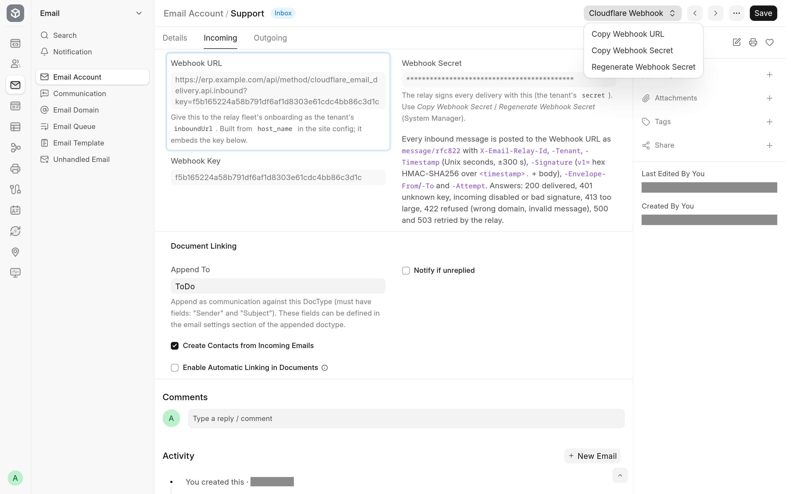

<!-- Copyright (c) 2026, Avunu LLC and contributors
For license information, please see license.txt-->

<!-- frappe-nix:begin header -->

<div align="center">


# Cloudflare Email Delivery

Send and receive Frappe email through Cloudflare, with no SMTP or IMAP server

[](https://github.com/Avunu/cloudflare_email_delivery/actions/workflows/ci.yml)
[](https://github.com/Avunu/cloudflare_email_delivery/releases)
[](license.txt)
[](https://github.com/frappe/frappe/tree/version-16)

<picture>
  <source media="(prefers-color-scheme: dark)" srcset="docs/screenshots/webhook-dark.webp">
  
</picture>

</div>

<!-- frappe-nix:end header -->

## Overview

Running e-mail for a Frappe or ERPNext site usually means SMTP credentials, IMAP polling and a mail provider in between. This app replaces both for sites whose domains are on Cloudflare. Outgoing mail goes from Frappe's `override_email_send` hook straight to the **Cloudflare Email Sending** REST API. Incoming mail arrives from the [Cloudflare email relay](https://github.com/Avunu/cloudflare-email-relay), a Worker that pushes each message to the site over a signed HTTPS webhook, and is handed to Frappe's own `InboundMail`, the same path IMAP polling uses. _Append To_, auto-replies, attachments, notifications and reply threading behave as they do for a mailbox.

It is the Frappe adapter of Avunu's Cloudflare Email suite, beside the relay, the Odoo module [`mail_cloudflare`](https://github.com/Avunu/avunu-odoo-addons/tree/18.0/mail_cloudflare) and the [WordPress plugin](https://github.com/Avunu/wordpress-cloudflare-email).

## Features

- **No SMTP to manage.** An Email Domain with **Send via Cloudflare** holds a Cloudflare account ID and API token instead of SMTP settings, and saving it verifies the token.
- **No IMAP polling.** An incoming Email Account on that domain gets a **Webhook URL** and a **Webhook Secret** when it is saved. The relay posts every message to the URL; the app checks the HMAC signature and the recipient domain, then creates the Communication (and the _Append To_ document) as Frappe does for a mailbox.
- **Threading that survives Cloudflare.** Cloudflare replaces the `Message-ID` of every message it sends. Frappe's own id is added to `References`, and inbound replies are matched on `References` as well as `In-Reply-To`, so a reply lands on the right document.
- Attachments, inline images (by `Content-ID`), `Reply-To` and the headers Cloudflare allows (`In-Reply-To`, `References`, `X-*`, `Precedence` and others) are sent.
- Rate limits and transient errors are retried briefly; an invalid token fails the rest of the batch at once; recipients Cloudflare bounces or suppresses up front fail the Email Queue entry with the reason.
- Copy and regenerate buttons for the webhook credentials on the Email Account form. Only a System Manager can see or regenerate the secret.
- Mixed setups work: accounts on other domains keep using SMTP or Frappe Mail.
- The webhook processes mail as a disabled, least-privilege user, never as Administrator.

<!-- frappe-nix:begin compatibility -->

## Compatibility

| Frappe | Branch       |
| ------ | ------------ |
| v16    | `version-16` |

<!-- frappe-nix:end compatibility -->

<!-- frappe-nix:begin installation -->

## Installation

On Frappe Cloud, install Cloudflare Email Delivery from the [Frappe marketplace](https://cloud.frappe.io/marketplace/apps/cloudflare_email_delivery).

On a bench of your own:

```bash
bench get-app https://github.com/Avunu/cloudflare_email_delivery --branch version-16
bench --site <site> install-app cloudflare_email_delivery
```

<!-- frappe-nix:end installation -->

Until the first release creates the `version-16` branch, install from `main` instead: `bench get-app https://github.com/Avunu/cloudflare_email_delivery --branch main`.

## Configuration

You need a Cloudflare account on the Workers Paid plan, with the domain onboarded for **Email Sending** and **Email Routing** enabled on its zone, and an API token with _Email Sending: Edit_. For incoming mail the site must be reachable over https with `host_name` set in its site config (the webhook URL is built from it), and the relay needs a tenant entry for the site.

**Sending**

1. On the **Email Domain**, tick **Send via Cloudflare** and fill in **Cloudflare Account ID** and **Cloudflare API Token**. Saving verifies the token.
2. On the **Email Account**, link the domain, set the address and tick **Enable Outgoing**. There is no password and no SMTP server to fill in.

**Receiving**

1. On the same Email Account, tick **Enable Incoming**, choose **Append To** (ToDo, Issue, Lead and so on) and the usual options (auto-reply, attachment limit, notifications), then save.
2. The **Cloudflare Email Receiving** section on the **Incoming** tab now shows the **Webhook URL**. Use **Cloudflare Webhook > Copy Webhook URL** and, as a System Manager, **Copy Webhook Secret**, and give both to the relay as the tenant's `inboundUrl` and `secret`, together with the domains whose mail should reach this site.
3. In the zone's **Email Routing**, route the addresses (or the catch-all) to the relay Worker.

**Regenerate Webhook Secret** changes the secret only. The URL stays the same, so only the tenant's secret in the relay needs updating; deliveries in between are parked as rejected on the relay and can be retried from there.

## How It Works

- `extend_doctype_class` stacks the app's controllers on **Email Domain** and **Email Account**; each one calls the stock controller for anything that is not on a Cloudflare domain. On a Cloudflare domain, the Email Domain verifies the API token instead of testing SMTP and IMAP connections, and the Email Account clears its server fields, generates the webhook key and secret once, builds the webhook URL and turns the scheduler's IMAP pull into a no-op.
- The `override_email_send` hook receives each recipient's copy of an Email Queue entry. For an account on a Cloudflare domain it posts the message to the Email Sending API, one call per recipient; for any other account it sends through Frappe Mail or SMTP, as core would.
- `cloudflare_email_delivery.api.inbound` is the webhook. It is a guest endpoint that accepts POST only: it caps the size, finds the account by the key in the URL, verifies the `X-Email-Relay-Signature` HMAC over the timestamp and body in constant time (a timestamp more than 300 seconds off is refused), checks that the recipient domain belongs to the account, and passes the raw message to `InboundMail`. Each status code tells the relay whether to retry; the [documentation](docs/README.md#the-webhook-contract) lists them with the headers.
- The message is processed as `cloudflare-email-relay@relay.invalid`, a disabled Website User whose only role, _Cloudflare Email Relay_, may read and write the Communications it owns. `bench migrate` creates the user and resets it to that shape.
- Retried deliveries are not duplicated: a message the site already has is recognised by the relay's queue id (`X-Email-Relay-Id`), and by its `Message-ID` as core does for IMAP.

## Limitations

- Asynchronous bounces never reach Frappe: the `Return-Path` is Cloudflare's, and bounces go to its own `cf-bounce` subdomain. Only the recipients Cloudflare rejects at send time are reported.
- Reply matching after Cloudflare's `Message-ID` rewrite relies on the replying client carrying `References`, which every mainstream client does.
- Cloudflare's limits apply: 5 MiB per message, 50 recipients, and 20 custom headers of at most 2 KB each. Headers outside Cloudflare's allow-list (`Disposition-Notification-To` and others) are dropped.
- Bcc recipients get their copy but are not listed anywhere in the delivered message, because Frappe sends each recipient a copy of its own.
- The help text under the webhook fields on the Email Account form says an unknown key or a disabled account gets a 404; the endpoint answers 401 for both, as the [webhook contract](docs/README.md#the-webhook-contract) says.

<!-- frappe-nix:begin support -->

## Support

- Bug reports and questions: [GitHub issues](https://github.com/Avunu/cloudflare_email_delivery/issues)
- E-mail: <mail@avu.nu>

<!-- frappe-nix:end support -->

<!-- frappe-nix:begin development -->

## Development

```bash
nix develop        # or: direnv allow
prek install       # the git hooks CI runs
frappe-test        # the tests, the way CI runs them
```

The managed files, checks and release flow are described in the [app standards documentation](https://docs.avunu.net/frappe-nix/docs/app-standards/).

<!-- frappe-nix:end development -->

The tests, the mail guard and the source layout are described in [docs/development.md](docs/development.md).

<!-- frappe-nix:begin license -->

## License

MIT, Copyright (c) 2026–present Avunu LLC → [license.txt](license.txt)

<!-- frappe-nix:end license -->

`cloudflare_email_delivery/cloudflare_api.py` derives from the AGPL-3.0 Odoo module of the same author and is relicensed here under MIT by its copyright holder, Avunu LLC.
