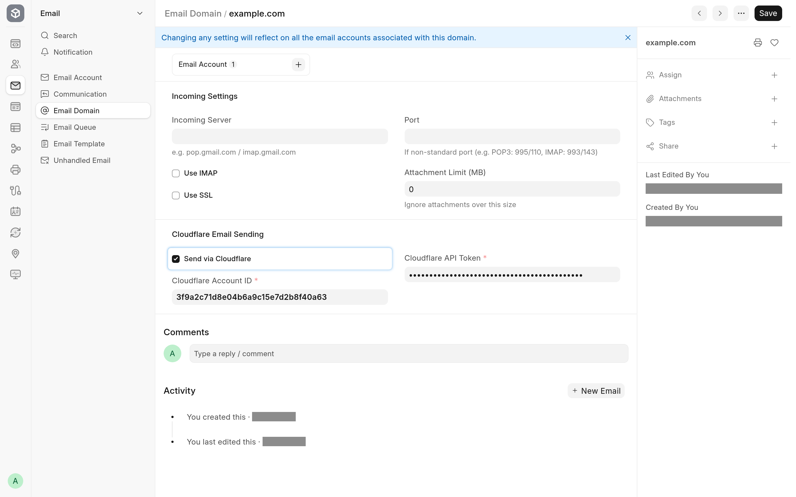

Outgoing mail keeps going through Frappe's Email Queue as before. What changes is the last step: instead of handing each message to an SMTP server, the app posts it to the Cloudflare Email Sending API.

## Before you start

- In Cloudflare: the domain onboarded for Email Sending, and an API token with the _Email Sending: Edit_ permission. Note the ID of the Cloudflare account that owns the domain.
- In Frappe: a System Manager login, and the app installed ([Install and upgrade](install.md)).

## Set up the Email Domain

1. Open the **Email Domain** for your domain, or create one with the domain in **Domain Name**.
2. In the **Cloudflare Email Sending** section, tick **Send via Cloudflare**.
3. Fill in **Cloudflare Account ID** and **Cloudflare API Token**.
4. Save.

Saving asks Cloudflare whether the token is active. If it is not, or if Cloudflare cannot be reached, the domain is not saved and the message names the reason: see [Limitations and troubleshooting](troubleshooting.md#saving-an-email-domain). The check confirms that the token is active, not that it carries the _Email Sending: Edit_ permission; a token without it fails on the first send.

## Set up the Email Account

1. Open or create the **Email Account** for the address you send from.
2. Set **Email Address**, pick the domain in **Domain**, and tick **Enable Outgoing**.
3. Save.

There is no password and no SMTP server to fill in. Saving clears the server fields and hides the password, IMAP and SMTP settings, because the account has no mail server. Tick **Default Outgoing** if this account should send the site's mail when no other account matches. The **Outgoing** tab's other options, such as **Always use this email address as sender address** and **Add Reply-To header**, keep working.

To receive on the same account, carry on with [Receive mail from the relay](receiving.md).

## What is sent

Frappe builds each message as usual and sends one copy per recipient. The app turns each copy into one API call with:

- the **From** address, the recipient (as **To** or **Cc**, as Frappe addressed that copy) and the first **Reply-To** address;
- the subject and the text and HTML bodies;
- the attachments, with inline images sent by their `Content-ID`;
- the headers Cloudflare accepts: `In-Reply-To`, `References`, every `X-` header, `Precedence`, `Auto-Submitted`, the `List-` headers and a few others.

Any other header is dropped, because Cloudflare would refuse the whole message for it. Cloudflare sets `Date`, `Message-ID`, `Return-Path` and the DKIM signature itself. Frappe's own `Message-ID`, the one Email Queue and Communication store, is added to `References` so that replies still find their way back: see [Reply threading](threading.md).

## When a send fails

Within one send, the app retries a rate limit (HTTP 429) after the time Cloudflare's `Retry-After` header asks for (2 and then 4 seconds without one), and a server error or a network error after 1 and then 2 seconds, three attempts in all. No wait is longer than 10 seconds. Any other refusal is not retried.

When the API call fails, Frappe records the error on the Email Queue entry and sets it back to **Not Sent** (or **Partially Sent** when other recipients already got their copy), and the scheduler tries it again later. Once the entry has been retried **Email Retry Limit** times (System Settings, 3 by default), the next failure sets it to **Error** and its owner gets a notification, "Failed to send email with subject: …". That retry cycle is Frappe's behaviour, the same as for SMTP.

Two cases fail at once:

- If Cloudflare rejects the API token (HTTP 401 or 403), every later message of the same batch fails without another call, with an error that begins "Not retried: an earlier send in this batch failed with".
- If Cloudflare answers that the recipient bounced permanently or is on its suppression list, the copy fails with "No recipient could be reached". Cloudflare reports only these immediate bounces; later bounces never reach Frappe.

The error messages and their fixes are listed in [Limitations and troubleshooting](troubleshooting.md#sending).

## Accounts on other domains

Only Email Accounts whose domain has **Send via Cloudflare** ticked use Cloudflare. Every other account keeps sending through its SMTP server or Frappe Mail, so you can move one domain at a time.
