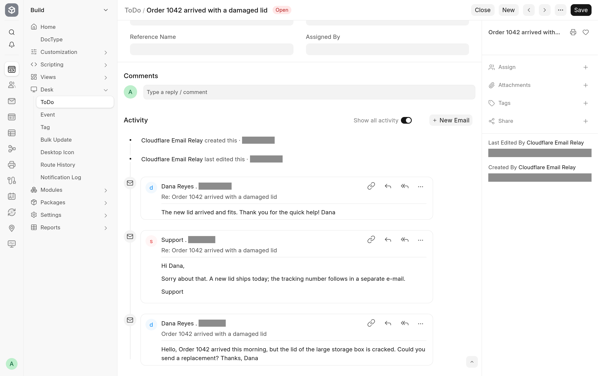

For desk users nothing changes: you send email from a document with **New Email** as before, and when the customer answers, the answer appears in that document's timeline. This page explains what makes that work, because Cloudflare changes one header Frappe normally relies on.

## The problem

Frappe gives every message it sends a `Message-ID` and stores it on the Email Queue entry and the Communication. When a reply comes in, Frappe reads its `In-Reply-To` header, finds the message it answers, and attaches the reply to the same document.

Cloudflare Email Sending replaces the `Message-ID` of every message with one of its own. The customer's mail program therefore puts Cloudflare's id in `In-Reply-To`, an id the site has never seen, and Frappe alone would treat the reply as a new message.

## What the app does

- **On the way out**, it adds Frappe's own `Message-ID` to the `References` header. If the message already answers another one, the earlier ids from `In-Reply-To` are kept in front of it. Mail programs copy `References` into their replies.
- **On the way in**, it looks at `In-Reply-To` first and then at `References`, newest id first, and takes the first id the site knows: one issued by this site, or one stored on a Communication or an Email Queue entry. Frappe then attaches the reply as usual.

A reply to a message sent through Cloudflare therefore lands on the document the message was sent from, and a customer's further answers land on that document too.

## When a reply does not thread

Threading depends on the customer's mail program keeping `References` in its reply. Every mainstream mail program does. A reply whose `References` and `In-Reply-To` carry no id the site knows is handled as a new message: with **Append To** set, it creates a new document. You can then link it to the right document by hand, as you would for any unmatched email in Frappe.

`References` may grow long in an old conversation. Cloudflare allows at most 2,048 bytes per header value, so the app drops the oldest ids first and always keeps Frappe's own.
